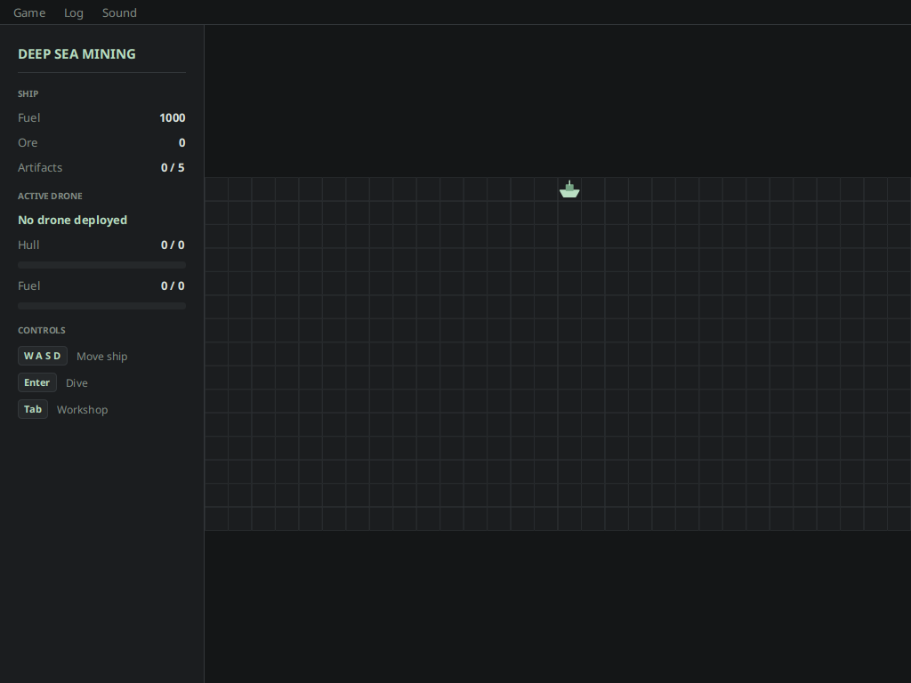
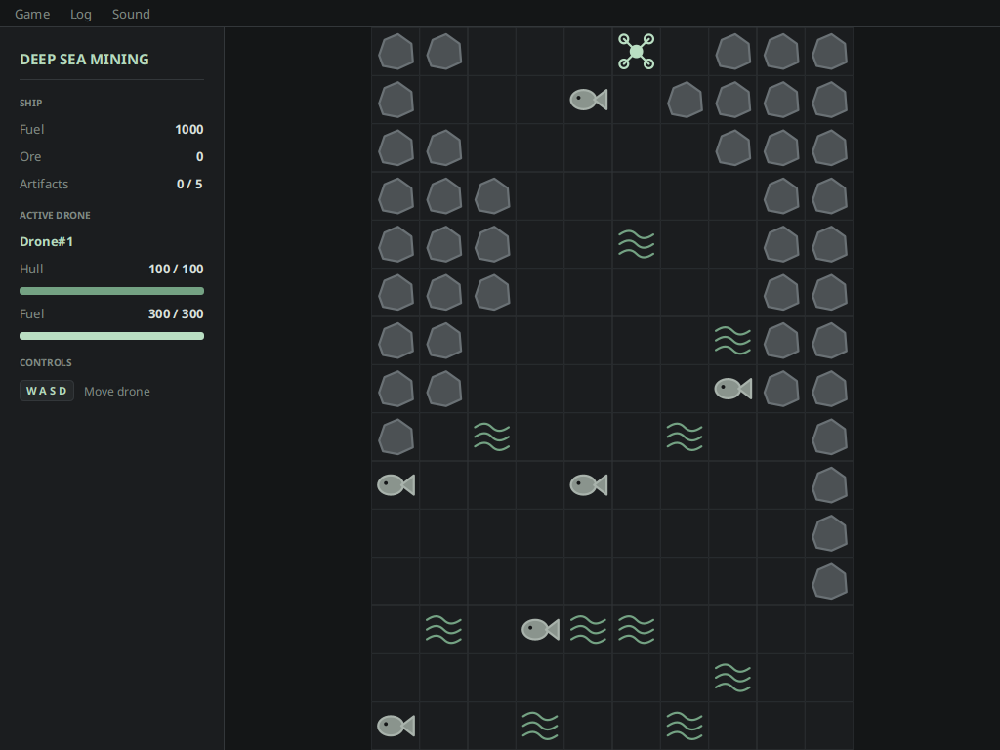
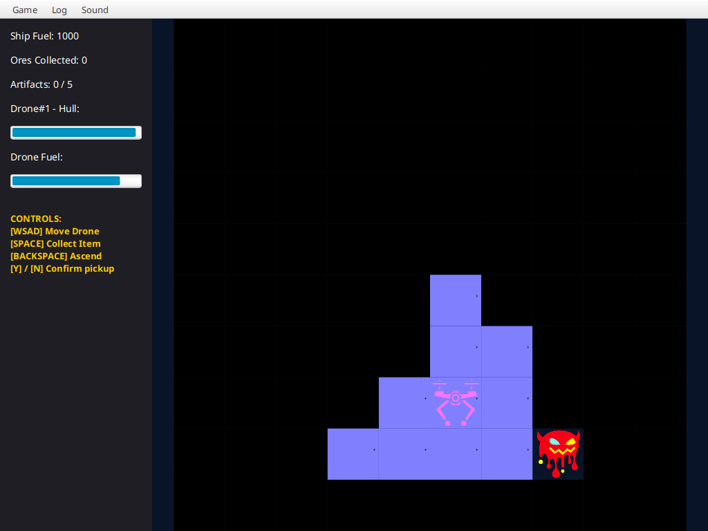
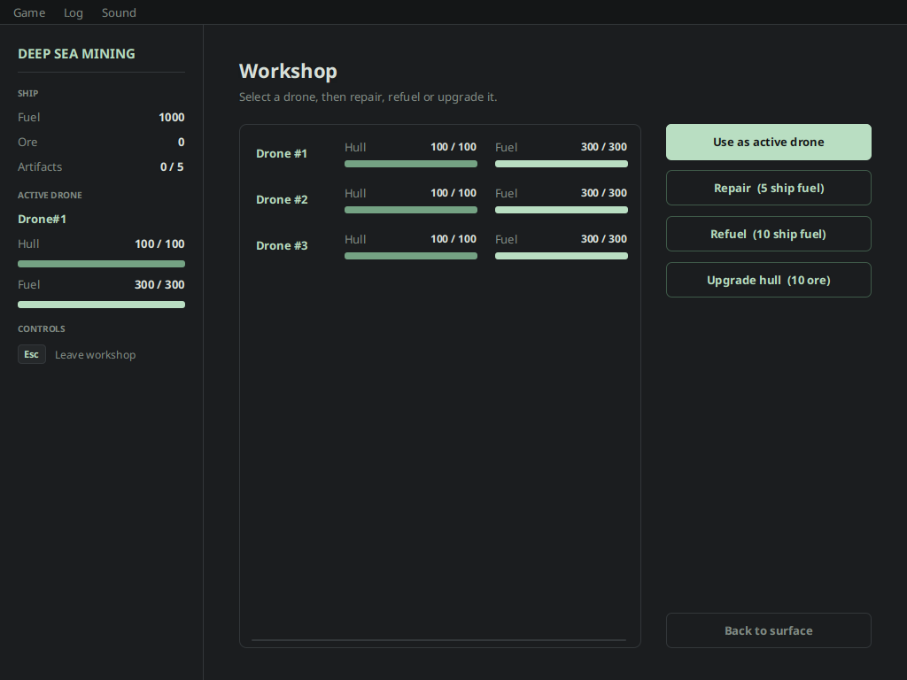
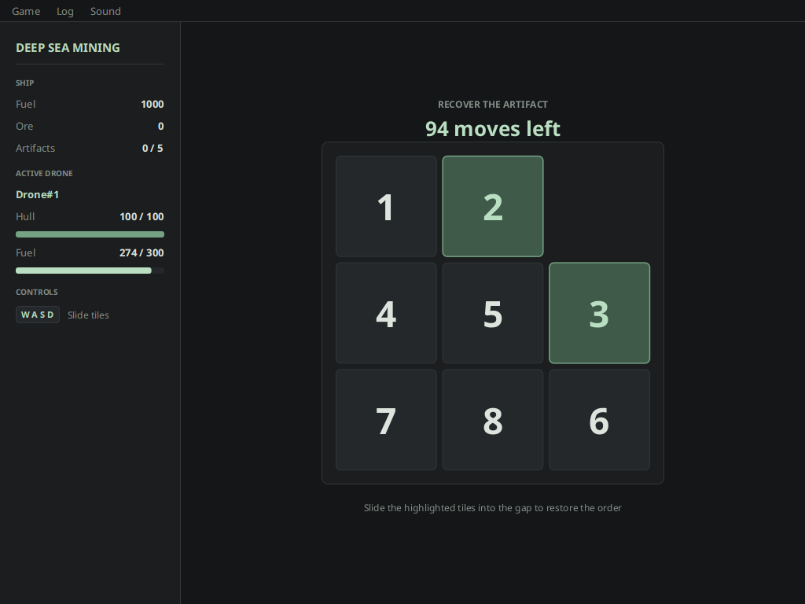

# Deep Sea Mining

A turn-based deep-sea mining game written in **Java** with **JavaFX**. You command a surface ship that
launches underwater drones through a trench down to the seabed, where they collect ore and recover
ancient artifacts while avoiding rocks, marine animals and monsters. The project was built for the
*Advanced Programming* course at ISEC (Portugal), and focuses on clean object-oriented design.

| Surface | Trench |
|---|---|
|  |  |
| **Seabed** (fog of war) | **Workshop** |
|  |  |



## Gameplay

1. **Surface** - move the ship, open the workshop or dive with a drone.
2. **Trench** - guide the drone down a rocky trench. Rocks and marine animals damage the hull,
   ocean currents increase fuel consumption.
3. **Seabed** - explore a hidden grid (cells are revealed as you move), collect ore and artifacts.
   Artifacts must be recovered by solving a sliding-tile puzzle (8-puzzle) within a limited number of moves.
4. **Workshop** - repair, refuel and upgrade drones using the ship's fuel and collected ore.

You win by recovering all **5 artifacts**. You lose when the ship runs out of fuel or has no drones left.

### Controls

| Context | Keys |
|---|---|
| Surface | `W A S D` move ship, `Enter` dive, `Tab` open workshop |
| Trench / Seabed | `W A S D` move drone |
| Seabed | `Space` collect, `Y` / `N` confirm pickup, `Backspace` ascend |
| Mini-game | `W A S D` or arrow keys slide tiles |
| Workshop | Mouse to manage drones, `Esc` to leave |

The menu bar offers saving/loading games (with a recent-games list), a real-time log window and a sound toggle.
A second window with an independent view of the same game is opened on start-up to demonstrate the MVC setup.

## Architecture

- **State pattern** - `Context` delegates every action to the current `IState`
  (`SurfaceState`, `TrenchState`, `SeabedState`, `WorkshopState`, `MiniGameState`, `GameOverState`).
  See the [state diagram](docs/state-diagram.pdf).
- **Model / UI separation** - the UI only talks to `Manager`, a facade that exposes the model and notifies
  views through `PropertyChangeSupport`. Several views can observe the same model.
- **Polymorphic grid elements** - `Rock`, `Ore`, `Artifact`, `Monster`, ... implement their own `interact` and
  `collect` behaviour, so `GameData` is not a god object.
- **Serialization** for save/load and a singleton `Log` for the in-game log.
- **Unit tests** (JUnit 5) cover the model, the state machine and the grids.

```
src/main/java/pt/isec/pa/deepsea
├── DeepSeaApp.java        entry point
├── model                  facade (Manager), context, states, constants, log
│   ├── data               ship, drones, grids and grid elements
│   └── state              concrete state implementations
└── ui                     JavaFX views (one canvas / pane per game state)
```

## Requirements

- JDK 21 or newer
- Maven 3.8+

## Build and run

```bash
mvn javafx:run      # start the game
mvn test            # run the unit tests
```

## License

Released under the [MIT License](LICENSE).
